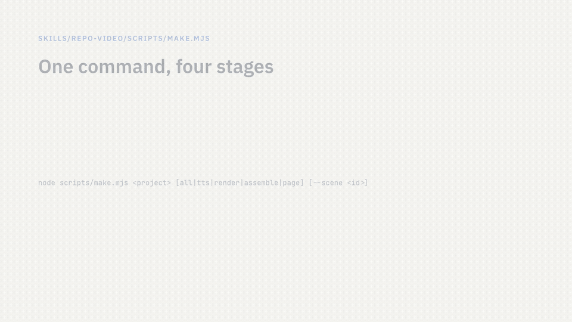
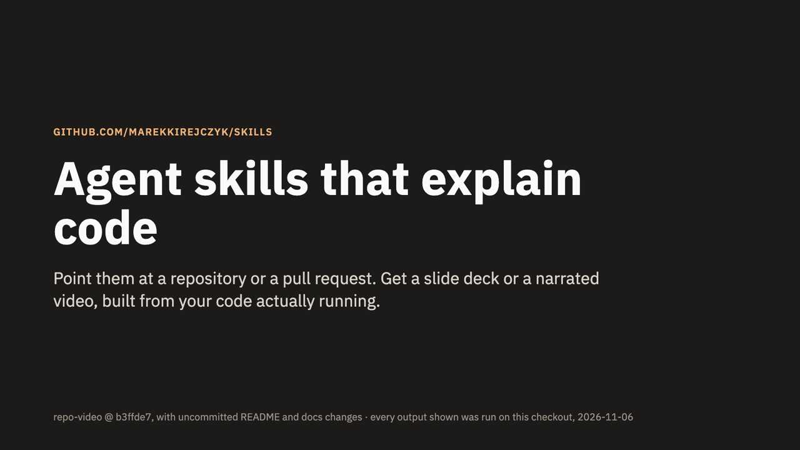

# Skills

**Explain any codebase or pull request, without writing a single slide.** Two agent skills that read your code, run it, and turn what they find into a walkthrough people actually watch: a slide deck, or a narrated video. A third skill, `refactor-tests`, brings your tests up to a written standard.

Works with Claude Code, Codex, Cursor and other agents that read `SKILL.md`.

## explain-with-video: a narrated explainer

[](https://claude.ai/artifact/9S3BAqPTEddbLFLnFgKBsP)

**[▶ Watch the example](https://claude.ai/artifact/9S3BAqPTEddbLFLnFgKBsP):** a 5-minute tour of this repository, made by `/explain-with-video`.

Scenes reveal their content step by step, and highlight exactly what the voice is talking about: a card, a line of code, a box in a diagram. You get an MP4 with captions, on a page with chapters and a clickable transcript.

```
/explain-with-video for a new backend developer     # the whole repository
/explain-with-video https://github.com/o/r          # a repository by URL
/explain-with-video pr 123                          # one pull request, for its reviewer
```

The voice is ElevenLabs if you add a key, or free macOS speech without one. [How it works →](docs/explain-with-video.md)

## explain-with-slides: a walkthrough deck

[](https://claude.ai/artifact/EQmgztM99GRNdBugNTMoZK)

**[▶ See the example deck](https://claude.ai/artifact/EQmgztM99GRNdBugNTMoZK):** this repository, presented by `/explain-with-slides`.

Each feature or change gets a screenshot from the code actually running, a diagram with its key files, and the real code. A PR deck adds before/after shots, diffs, the test run and review risks.

```
/explain-with-slides for a new backend developer   # the whole repository
/explain-with-slides https://github.com/o/r        # a repository by URL
/explain-with-slides pr 123                        # one pull request, for its reviewer
```

[How it works →](docs/explain-with-slides.md)

## refactor-tests: tests to a written standard

Brings the tests of a file, a class or a branch up to the rules for each test type (pure functions, services, route handlers, database round trips), and covers every case those rules name. It refactors in small rounds that stay green. A bug it finds is reported and pinned by a test, not fixed.

```
/refactor-tests src/orders/order-service.ts   # a file or a class
/refactor-tests pr 123                        # a branch's changes
```

The rules assume TypeScript, Vitest and pnpm.

## Install

**Claude Code**, all three skills as a plugin that updates itself:

```bash
claude plugin marketplace add marekkirejczyk/skills
claude plugin install marekkirejczyk-skills@marekkirejczyk
```

**Codex, Cursor and other agents**, one skill at a time:

```bash
npx skills add marekkirejczyk/skills --skill explain-with-video          # or explain-with-slides, refactor-tests
```

Then type `/explain-with-video`, `/explain-with-slides` or `/refactor-tests` (`$explain-with-video` in Codex). Each runs only when you ask for it. [More install options →](docs/installation.md)

## Using the explainers

```
/<skill>                                      # the whole repository
/<skill> https://github.com/o/r               # another repository, by URL
/<skill> pr 123                               # a pull request: number, URL, branch, or nothing for the current branch
/<skill> pr 123 polish, for the reviewer      # then a language, then an audience or focus
```

`explain-with-video` and `explain-with-slides` show you an outline first and build only after you approve it. Each opens with a cover, numbered contents and a detailed summary, then architecture and the rest. Everything they show comes from running your code: no mockups, no invented numbers.

## License

MIT
