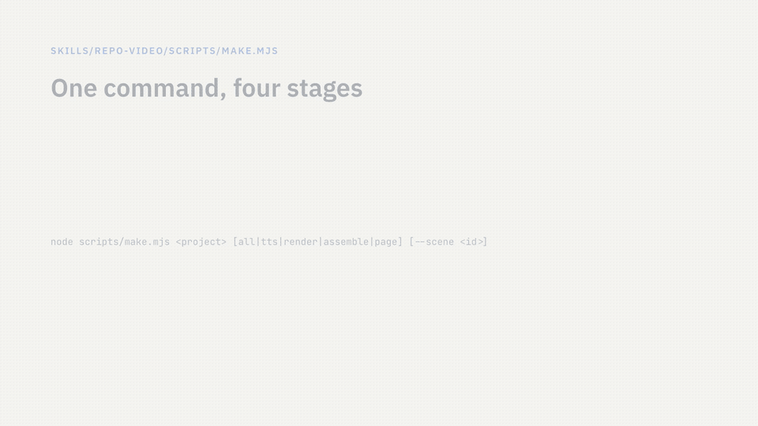
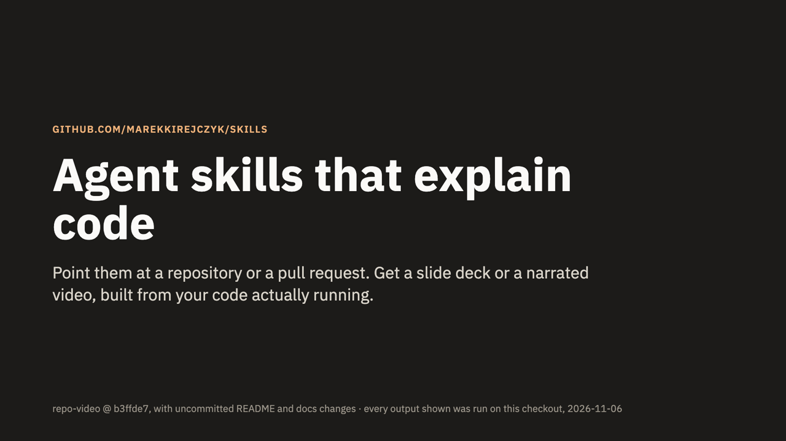

# Skills

**Agent skills for the whole life of a change: cleaner code, code you can understand, and a pull request that gets merged.** Each one reads your code, runs it, and does the work end to end, so you review results instead of writing prompts.

Works with Claude Code, Codex, Cursor and other agents that read `SKILL.md`.

### 🧹 Code quality

Bring code up to a written standard, without changing what it does. Each skill works in small rounds on its own branch, keeps the tests green, and leaves the decisions only you can make as a list at the end.

- **[`/refactor-tests`](#refactor-tests-tests-to-a-written-standard)**: tests rewritten to the rules for their type, with every case covered.
- **[`/self-documented-code`](#self-documented-code-names-that-explain-themselves)**: names that explain themselves, one name per concept, comments only for the why.
- **[`/dont-repeat-yourself`](#dont-repeat-yourself-one-implementation-per-concept)**: one well-tested implementation of each concept that was written several times.
- **[`/refactor-evals`](#refactor-evals-one-requirement-per-case)**: eval cases split to one requirement each, duplicates merged, every red case diagnosed.

### 🔍 Understanding code

See what a codebase, a pull request or an eval run actually does. Everything they show comes from running your code: no mockups, no invented numbers.

- **[`/explain-with-video`](#explain-with-video-a-narrated-explainer)**: a narrated MP4 of a repository or a pull request, with captions, chapters and a transcript.
- **[`/explain-with-slides`](#explain-with-slides-a-walkthrough-deck)**: a walkthrough deck with screenshots from the running code, diagrams and real code.
- **[`/eval-report`](#eval-report-evals-you-can-review-in-a-minute)**: every eval run on one HTML page, filterable to what failed or changed, locally or on CI.

### 🚀 Workflow

Take a branch from "it works" to merged, without babysitting it yourself.

- **[`/finish-pr`](#finish-pr-from-it-works-to-a-pull-request-ready-to-merge)**: the branch reviewed, fixed and opened as a described pull request, with its previews and code owners.
- **[`/baby-sitting`](#baby-sitting-a-pull-request-looked-after-until-it-merges)**: the pull request kept rebased, green and answered until it merges.

## Install

**Claude Code**, all ten skills as a plugin that updates itself:

```bash
claude plugin marketplace add marekkirejczyk/skills
claude plugin install marekkirejczyk-skills@marekkirejczyk
```

**Codex, Cursor and other agents**, one skill at a time:

```bash
npx skills add marekkirejczyk/skills --skill explain-with-video          # or explain-with-slides, refactor-tests, self-documented-code, dont-repeat-yourself, eval-report, refactor-evals, baby-sitting, finish-pr
```

Then type `/explain-with-video`, `/explain-with-slides`, `/refactor-tests`, `/self-documented-code`, `/dont-repeat-yourself`, `/eval-report`, `/refactor-evals`, `/baby-sitting` or `/finish-pr` (`$explain-with-video` in Codex). Each runs only when you ask for it. [More install options →](docs/installation.md)

## Code quality

### /refactor-tests: tests to a written standard

Brings the tests of a file, a class or a branch up to the rules for each test type (pure functions, services, route handlers, database round trips, browser journeys), and covers every case those rules name. It pushes each test down to the fastest level that can prove it and removes duplicates, proving each removal by breaking the code. It refactors in small rounds that stay green, measures tests, files and the whole suite against speed budgets, and puts a table of time per test category on the PR. A bug it finds is reported and pinned by a test, not fixed.

```
/refactor-tests src/orders/order-service.ts   # a file or a class
/refactor-tests pr 123                        # a branch's changes
```

The rules assume TypeScript, Vitest and pnpm, with Playwright for browser tests.

### /self-documented-code: names that explain themselves

Reviews every name in a scope, renames what falls short so each concept has one name, keeps comments only for what the code cannot say, and updates the project's glossary to match. It runs without stopping for approval, on its own branch with one commit per round. Lint, tests and behaviour stay as they were, and names other systems depend on (API fields, database columns) are reported rather than changed.

```
/self-documented-code                          # the whole repository
/self-documented-code pr 123                   # the names a PR adds or changes
/self-documented-code src/payments             # a directory, file or concept
```

### /dont-repeat-yourself: one implementation per concept

Finds concepts implemented more than once, even when the copies are written differently, and gives each one shared, tested implementation. Copies with identical behaviour are extracted automatically, on their own branch with one commit per extraction. Copies that differ, look-alikes that may be separate concepts, and anything touching money, auth, migrations or locking come to you as one list of decisions at the end.

```
/dont-repeat-yourself                          # the whole repository
/dont-repeat-yourself pr 123                   # a PR's new code, against the whole repository
/dont-repeat-yourself src/payments             # a directory, file or concept
```

### /refactor-evals: one requirement per case

Brings an eval suite's cases up to written rules. It lists every expectation against the requirement it holds, then splits each case that bundles several requirements, merges cases that hold one requirement in one scenario, moves what holds for every reply to one place, and puts each check at the cheapest grader that can decide it: code before a judge. Nothing is removed until a hand-written bad reply is shown to go red on what stays. Failing and unsteady cases each get a verdict (the harness, the case, the agent, or the requirement), and a case is never loosened to pass. Rules for the fake world, retries and the judge come as findings.

```
/refactor-evals                                # the whole suite
/refactor-evals evals/cases/refunds.json       # a file or a folder of cases
/refactor-evals pr 123                         # the cases a PR adds or changes
/refactor-evals failing                        # the cases red or marked in the latest run
```

It works on any runner and case format: it reads the suite's README and schema first. Trials call your model, so it says how many calls it will make before it runs them.

The rules are good practices taken from published sources, not invented here:

| Rules | Taken from |
| --- | --- |
| One thing graded at a time, unambiguous cases, both sides of a boundary, the outcome graded and not the path, a new environment for every trial, reading transcripts before trusting a score | Anthropic, [Demystifying evals for AI agents](https://www.anthropic.com/engineering/demystifying-evals-for-ai-agents) |
| Code checks before a judge, pass or fail and no scales, cases written from real failures, a judge calibrated against labelled examples | Hamel Husain, [evals FAQ](https://hamel.dev/blog/posts/evals-faq/) and [Creating a LLM-as-a-judge that drives business results](https://hamel.dev/blog/posts/llm-judge/) |
| What a judge gets wrong, and why its model is set apart from the subject's | Eugene Yan, [Evaluating the effectiveness of LLM-evaluators](https://eugeneyan.com/writing/llm-evaluators/) |
| Tools faked where they are run, with fixed answers and injected errors, around an agent left as it is | Google ADK, [environment simulation](https://adk.dev/evaluate/environment_simulation/) |
| Several trials, and passing all of them | [τ-bench](https://arxiv.org/abs/2406.12045) |
| A mark that carries its reason | pytest, [strict `xfail`](https://docs.pytest.org/en/stable/how-to/skipping.html) |

A few rules have no published source and are ordinary testing practice applied to evals: a frozen clock, fixtures parsed with the real types, and a lookup no fixture names failing the case. The ledger, and proving each change on a hand-written good and bad reply, are this skill's own way of applying them.

## Understanding code

### /explain-with-video: a narrated explainer

[](https://claude.ai/artifact/9S3BAqPTEddbLFLnFgKBsP)

**[▶ Watch the example](https://claude.ai/artifact/9S3BAqPTEddbLFLnFgKBsP):** a 5-minute tour of this repository, made by `/explain-with-video`.

Scenes reveal their content step by step, and highlight exactly what the voice is talking about: a card, a line of code, a box in a diagram. You get an MP4 with captions, on a page with chapters and a clickable transcript.

```
/explain-with-video for a new backend developer     # the whole repository
/explain-with-video https://github.com/o/r          # a repository by URL
/explain-with-video pr 123                          # one pull request, for its reviewer
```

The voice is ElevenLabs if you add a key, or free macOS speech without one. [How it works →](docs/explain-with-video.md)

### /explain-with-slides: a walkthrough deck

[](https://claude.ai/artifact/EQmgztM99GRNdBugNTMoZK)

**[▶ See the example deck](https://claude.ai/artifact/EQmgztM99GRNdBugNTMoZK):** this repository, presented by `/explain-with-slides`.

Each feature or change gets a screenshot from the code actually running, a diagram with its key files, and the real code. A PR deck adds before/after shots, diffs, the test run and review risks.

```
/explain-with-slides for a new backend developer   # the whole repository
/explain-with-slides https://github.com/o/r        # a repository by URL
/explain-with-slides pr 123                        # one pull request, for its reviewer
```

[How it works →](docs/explain-with-slides.md)

### Using the explainers

```
/<skill>                                      # the whole repository
/<skill> https://github.com/o/r               # another repository, by URL
/<skill> pr 123                               # a pull request: number, URL, branch, or nothing for the current branch
/<skill> pr 123 polish, for the reviewer      # then a language, then an audience or focus
```

`explain-with-video` and `explain-with-slides` show you an outline first and build only after you approve it. Each opens with a cover, numbered contents and a detailed summary, then architecture and the rest. Everything they show comes from running your code: no mockups, no invented numbers.

### /eval-report: evals you can review in a minute

Runs your evals and builds one static HTML page from what they recorded: pass counts at the top, a collapsible section per eval file, and a row per run with its input, output, judges and checks (green or red), and the tools it called with what they gave. Filter to failed runs, to cases new or changed in the commit or PR, or to what you haven't reviewed yet: tick runs as reviewed, and a tick clears itself when that run's result changes. Each case links to its code; light and dark themes. A script does the work, so it costs no tokens.

```
/eval-report                  # every eval
/eval-report pr               # every eval, with this PR's new or changed cases marked
/eval-report only pr          # only the eval files this PR changed
/eval-report-install-ci       # the same on GitHub Actions, linked from every PR
```

Your eval runner writes one JSON line per run to the file `EVAL_REPORT_FILE` names; the skill adds that to it once. [The format →](skills/eval-report/reference/input-format.md)

## Workflow

### /finish-pr: from "it works" to a pull request ready to merge

The last part of every pull request, done the same way each time. Sub-agents review the branch on separate axes while the repository's own checks run: its written standards, the spec it was built from, a hunt for bugs it can show with an input, and its design system when the change draws UI. It fixes what is worth fixing without asking and lists the rest with a reason. Then it pushes, opens the PR ready for review with a description (your PR template, or summary, evidence and risk), and tells you what you need to act: the PR and its preview links, what the review found, and each changed file that has a code owner, linked to its diff. It finishes by running `/baby-sitting` on the PR.

```
/finish-pr            # manual: reviewed, opened, kept green; you merge
/finish-pr auto       # the same, merged by GitHub once green and approved
```

The Standards and Spec axes follow the idea of Matt Pocock's [`/code-review`](https://github.com/mattpocock/skills): two reviews that can't mask each other. It needs `/baby-sitting` installed beside it, and `gh`, `jq` and `git`. It prints how long each phase took, so a slow one shows.

### /baby-sitting: a pull request looked after until it merges

Watches the current branch's pull request and deals with what happens to it. A red check gets read, fixed and pushed. When the base branch moves, the branch is rebased, conflicts resolved, and the repository's own checks run again before the push. When the review bot comments, you get one numbered list with a verdict on each comment (fix, push back, already done); you pick, it fixes those, and it replies on every thread. Then it tells you the PR is ready and keeps watching until you merge.

```
/baby-sitting            # manual: kept rebased, green and answered; you merge
/baby-sitting auto       # GitHub auto-merge: merged once green and approved
```

One script polls GitHub every 20 seconds and wakes the agent only when something happens, so waiting costs no tokens. The review bot is CodeRabbit unless you name another (`REVIEW_BOT`), or none. It needs `gh`, `jq` and `perl`.

## License

MIT
